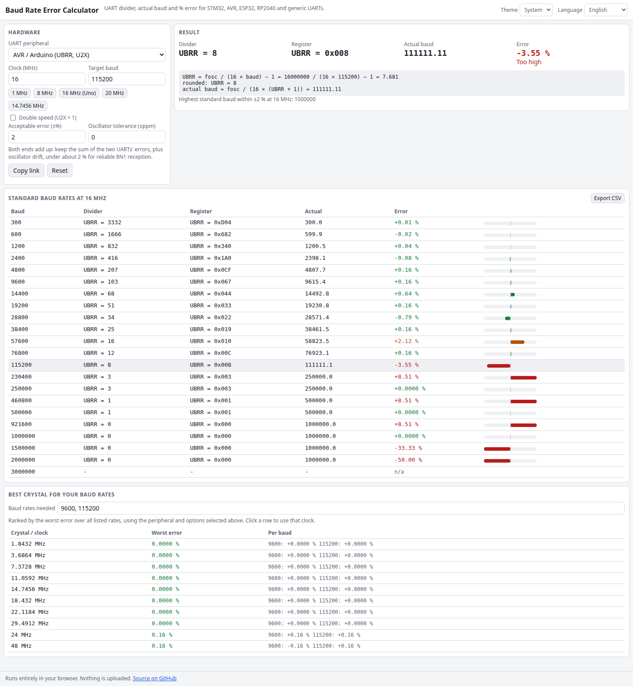

# Baud Rate Error Calculator

Pick your UART peripheral and clock, and see the divider the hardware will really use, the baud rate you actually get, and the error in percent. It covers STM32 USART (with oversampling by 8 or 16) and LPUART, AVR with and without U2X, the ESP32 fractional divider, the RP2040 PL011 and a generic divider with optional fractional bits. A table lists every standard baud with its error, and a crystal finder ranks standard frequencies for the baud rates you need.

**Try it: [hermes98761234.github.io/baud-rate-error-calculator](https://hermes98761234.github.io/baud-rate-error-calculator/)**

[](https://github.com/hermes98761234/baud-rate-error-calculator/actions/workflows/deploy.yml)



## Features

- **Exact register values**: `UBRR`, `BRR` (mantissa and fraction), `CLKDIV` and `FRAG`, `IBRD` and `FBRD`, shown in decimal and hex, with the formula and your numbers substituted.
- **Standard-baud table** from 300 to 3 000 000 with colour-coded error bars and CSV export. Click a row to inspect it.
- **Crystal suggestions**: list the baud rates you need and get the standard crystals ranked by worst-case error (3.6864, 7.3728, 11.0592, 14.7456 MHz and friends come out at 0 % on AVR).
- **Tolerance checks**: set an acceptable error and an oscillator tolerance in ppm to get a worst-case verdict.
- **Presets** for common clocks, a shareable link with the whole state, English and Ukrainian, light and dark theme. Nothing leaves your browser.

## How it works

| Peripheral | Divider | Actual baud |
| --- | --- | --- |
| STM32 USART | `USARTDIV = fck / (8·(2−OVER8)·baud)`, kept with 4 or 3 fraction bits | `fck / N`, `N = round(fck/baud)` |
| STM32 LPUART | `BRR = round(256·fck / baud)`, at least `0x300` | `256·fck / BRR` |
| AVR | `UBRR = round(fosc / (16·baud)) − 1` (8 with U2X) | `fosc / (16·(UBRR+1))` |
| ESP32 | `clk / baud` with a 4-bit fraction | `clk / (int + frac/16)` |
| RP2040 | `BRD = clk / (16·baud)`, `FBRD = round(frac·64)` | `clk / (16·(IBRD + FBRD/64))` |
| Generic | `round(fclk / (k·baud)·2^f) / 2^f` | `fclk / (k·div)` |

The unit tests check textbook values: AVR 16 MHz gives UBRR 103 for 9600 baud (+0.16 %) and -3.55 % at 115200, STM32 at 72 MHz is exact for 115200 (`BRR = 0x0271`), and the Pico SDK values `IBRD = 67, FBRD = 52` for 115200 at 125 MHz.

## Quick start

You need [Node.js](https://nodejs.org/) 22.

```bash
git clone https://github.com/hermes98761234/baud-rate-error-calculator.git
cd baud-rate-error-calculator
npm install
npm run dev       # http://localhost:5173
npm test          # divider formulas and crystal search
npm run build     # static site in dist/
```

## License

MIT
